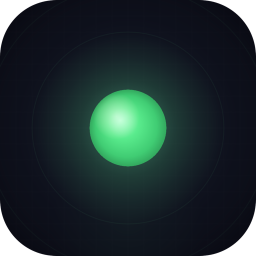

<div align="center">



# Aura

**Your Mac, voice-controlled.**

[](https://www.apple.com/macos/)
[](https://www.swift.org)
[](https://ai.google.dev/)
[](LICENSE)

</div>

Aura lives in your menu bar. Talk to it and it hears you, sees your screen, and does things for you: opens apps, clicks, types, uses menus, drives web pages, runs AppleScript, and looks things up.

> *"Open Safari and go to the project board."*
> *"What's on my screen? Summarize it."*
> *"Reply to this email saying I'll be there at 3."*
> *"Remember that I prefer dark mode."*

It's one native Swift app talking directly to the [Gemini Live API](https://ai.google.dev/gemini-api/docs/live). There's no server and no account; all you need is a free Gemini API key.

## Get started

You need macOS 14+ and Xcode or the Command Line Tools (`xcode-select --install`).

```bash
git clone https://github.com/abdul-abdi/aura.git && cd aura
bash scripts/dev.sh
```

This builds `Aura.app`, installs it to `/Applications`, and launches it. Click the dot in the menu bar, then:

1. **Paste your Gemini API key.** Get one free at [aistudio.google.com/apikey](https://aistudio.google.com/apikey).
2. **Allow the permissions:** Microphone (to hear you), Screen Recording (to see your screen), and Accessibility (to click and type). macOS may ask you to reopen Aura after granting Screen Recording.
3. **Click Start and talk.**

Aura is always listening, with echo cancellation, so you can interrupt it mid-sentence. Press **⌘⇧A** to mute or unmute. You can also type in the panel.

## How it works

```
 Mic ──► AVAudioEngine (voice processing / echo cancellation) ──► 16 kHz PCM ─┐
 Screen ─► ScreenCaptureKit (≈1 fps while it changes) ──────────► JPEG ───────┤
                                                                              ▼
                                                              Gemini Live (WebSocket)
                                                                              │
 Speakers ◄── 24 kHz PCM ◄────────────────────────────────────────────────────┤
 Your Mac ◄── tools: Accessibility, CGEvent, NSWorkspace, AppleScript ◄────────┘
```

| File | What it does |
|---|---|
| `Live.swift` | Gemini Live WebSocket client. Reconnects forever and resumes the conversation from the server's resumption handle (covers sleep/wake and network drops). |
| `Audio.swift` | Microphone and speaker via `AVAudioEngine` with Apple's voice processing, so Aura never hears itself and you can talk over it. |
| `Screen.swift` | Captures the display under the pointer and maps the model's 0–1000 coordinates to real screen points. |
| `Tools.swift` | The tools Gemini can call, each blocking until its result plus a fresh screenshot is back. |
| `AX.swift`, `Input.swift` | Accessibility tree (clickable elements, menus, focus) and synthetic mouse/keyboard events. |
| `Aura.swift`, `Panel.swift`, `AuraApp.swift` | Wiring, the menu bar panel (setup, live transcript, text input), and the ⌘⇧A hotkey. |
| `Config.swift`, `Prompt.swift` | Settings, memory and permissions; the instructions Gemini runs with. |

**Tools:** `get_screen_context`, `click_element`, `click`, `type_text`, `press_key`, `scroll`, `drag`, `open`, `click_menu`, `run_applescript`, `run_browser_js`, `set_clipboard`, `remember`, `forget`, `quit_aura`, plus Google Search.

**Memory:** when you tell Aura something worth keeping, it saves it to `~/Library/Application Support/Aura/memory.json` and includes it in every new session.

## Configuration

Settings live in `~/.config/aura/config.toml`. Environment variables take precedence.

```toml
api_key = "your-gemini-api-key"   # or GEMINI_API_KEY
# model = "gemini-3.8-live"       # or AURA_MODEL: any Gemini Live model
# voice = "Kore"                  # or AURA_VOICE: any prebuilt Gemini voice
```

If Google retires a model, set `model` to a current one. Run `log stream --predicate 'subsystem == "com.aura.desktop"'` to see connection and tool errors.

## Safety

Aura acts on your Mac, so it is told to ask before anything destructive (deleting files, sending messages, purchases) and to ignore instructions that appear on screen or in web pages. AppleScript `do shell script` is blocked. Every action shows up in the panel as it happens.

## Development

```bash
swift test                      # unit tests
bash scripts/bundle.sh          # build build/Aura.app
bash scripts/bundle.sh --dmg    # plus a .dmg
bash scripts/uninstall.sh       # remove Aura, its settings and permissions
```

[Apache-2.0](LICENSE)
